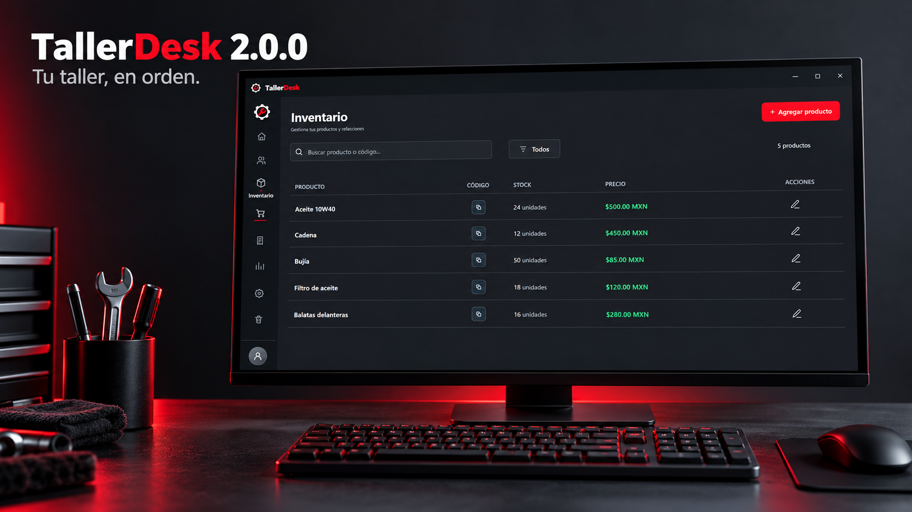
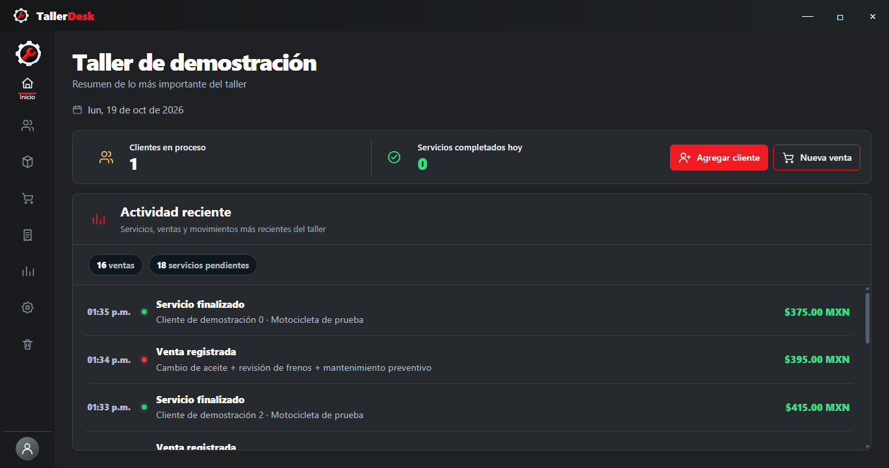
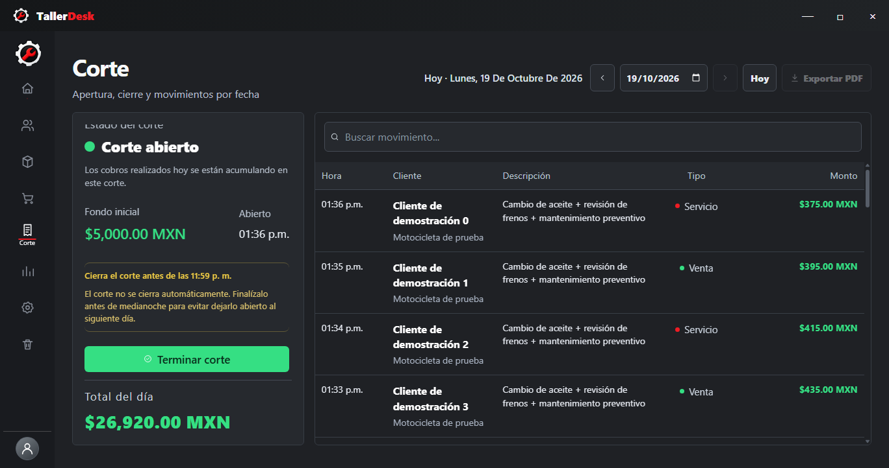
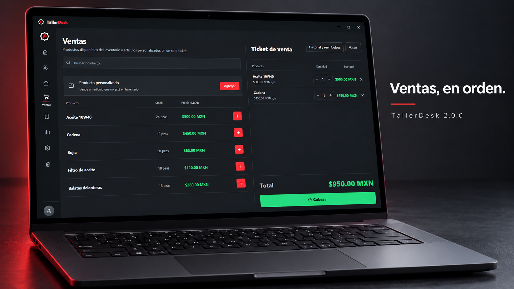
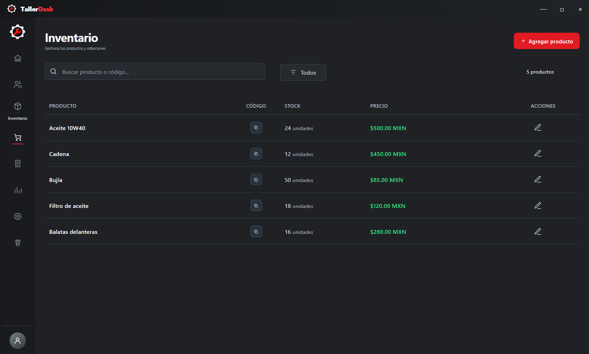
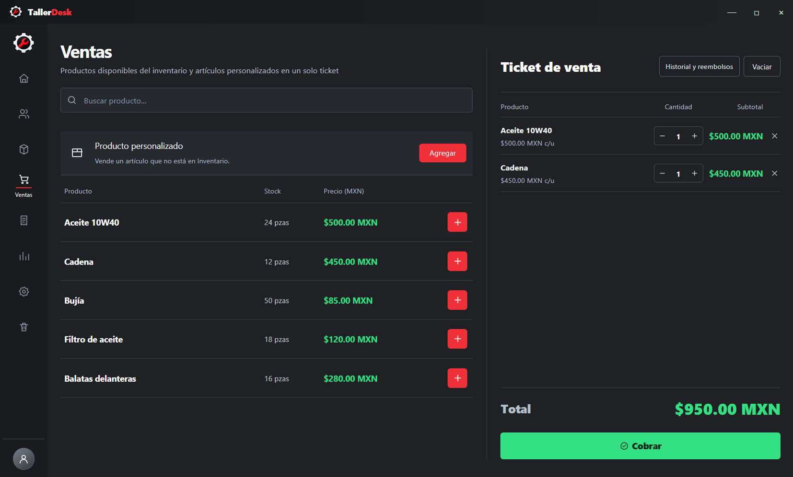

# TallerDesk

**Tu taller, en orden.** Aplicación de escritorio para administrar talleres de motocicletas.

Desarrollado por **Kevin · LionEdge**. Organiza la recepción de motocicletas, los servicios, el inventario y los cobros desde una interfaz oscura y minimalista.

## Nueva versión · 2.0.2

[Ver todos los cambios de la versión 2.0.2](https://github.com/KevinJHernandez/TallerDesk/releases/tag/v2.0.2).

**Software comercial.** La descarga es pública; para utilizar TallerDesk necesitas una cuenta autorizada por el desarrollador. Descargar o instalar el programa no activa el acceso. [Solicita información o una demostración](https://github.com/KevinJHernandez).

### Correcciones de la 2.0.2

- Menú completo en ventanas pequeñas, incluyendo el acceso a la cuenta.
- Paleta roja predeterminada corregida: los controles ya no quedan negros por falta de color.
- Inicio con actividad reciente e importes más legibles y espacio aprovechado.
- Corte ajustado al tamaño disponible, con total visible y detalles desplazables en alturas pequeñas.
- Comparación de Estadísticas y pestañas de Configuración accesibles al reducir la ventana.
- Revisión con datos de demostración: 43 pruebas funcionales y 126 comprobaciones de diseño, incluyendo escala de 125 %, cinco colores y formularios con muchos servicios.

Ver Inicio y Corte en tamaño de laptop

Capturas del programa con datos de demostración.

### Funciones de la versión 2

| Apartado | Novedades de la versión 2 |
|---|---|
| Diseño | Interfaz minimalista, tonos grises, color de acento personalizable y ajustes para ventanas compactas. |
| Clientes y servicios | Historial, motivos de cancelación y comprobantes con un diseño consistente para servicios terminados y cancelados. |
| Ventas | Ticket compacto, cantidades alineadas, artículos personalizados e historial de cobros. |
| Reembolsos | Devoluciones parciales o totales, motivo, autorización administrativa y regreso opcional de productos al stock. |
| Inventario | Cantidades visibles, búsqueda, filtros y estados vacíos renovados. |
| Corte | Panel lateral, apertura y cierre, movimientos de ventas, servicios y reembolsos. |
| Estadísticas | Ingresos por día, comparación de fechas e identificación del día actual. |
| Papelera | Selección múltiple, restauración y eliminación con autorización administrativa. |
| Configuración | Pestañas para cuenta, apariencia, sincronización, seguridad y datos del programa. |

### Así se ve

*Montajes de presentación basados en pantallas del programa, con datos de demostración. El color del tema se puede personalizar.*

Ver capturas del programa

## Versión anterior · 2.0.1

[Descargar TallerDesk 2.0.1](https://github.com/KevinJHernandez/TallerDesk/releases/download/v2.0.1/TallerDesk-Setup-2.0.1.exe) · [Ver detalles](https://github.com/KevinJHernandez/TallerDesk/releases/tag/v2.0.1)

## Versión anterior · 2.0.0

[Descargar TallerDesk 2.0.0](https://github.com/KevinJHernandez/TallerDesk/releases/download/v2.0.0/TallerDesk-Setup-2.0.0.exe) · [Ver detalles](https://github.com/KevinJHernandez/TallerDesk/releases/tag/v2.0.0)

## Versión anterior · 1.0.0

La primera versión permanece disponible como referencia y descarga anterior.

[Descargar TallerDesk 1.0.0 para Windows de 64 bits](https://github.com/KevinJHernandez/TallerDesk/releases/download/v1.0.0/TallerDesk-Setup-1.0.0.exe) · [Ver detalles](https://github.com/KevinJHernandez/TallerDesk/releases/tag/v1.0.0)

## Antes de instalar o actualizar

- Necesitas Windows de 64 bits y una cuenta autorizada. El primer acceso requiere internet.
- Antes de actualizar, espera a que se sincronicen las operaciones pendientes y conserva una copia de tus datos.
- El trabajo sin conexión utiliza los datos cargados previamente en esa computadora; los pendientes se intentan enviar al reconectar.
- Las comprobaciones locales de la versión 2 incluyen 43 casos automatizados y compilación. La instalación y la sincronización real deben verificarse en el equipo de destino.

El instalador aún no tiene firma digital de editor. Windows puede mostrar una advertencia de aplicación no reconocida; esta actualización no elimina ese aviso.

## Sobre el proyecto

TallerDesk utiliza **Electron, JavaScript, HTML, CSS y Firebase**. Incluye almacenamiento local para operaciones pendientes y controles de sincronización.

Este repositorio contiene la presentación y los instaladores públicos. **El código de desarrollo y los datos de los talleres no se incluyen aquí.**

Desarrollado por **Kevin · LionEdge** · [Información y contacto](https://github.com/KevinJHernandez)
